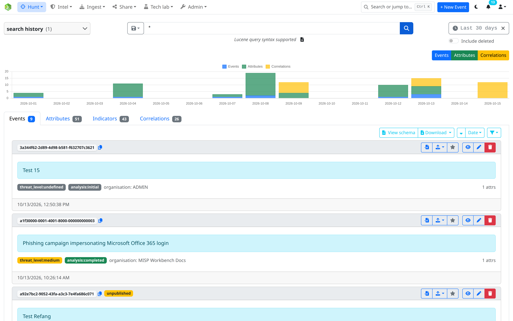
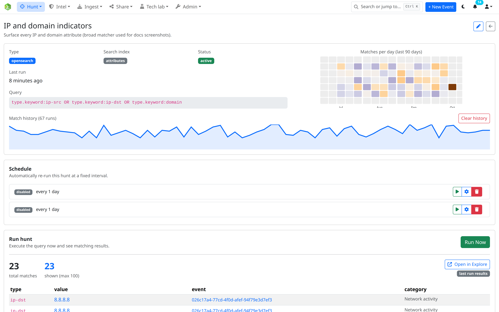
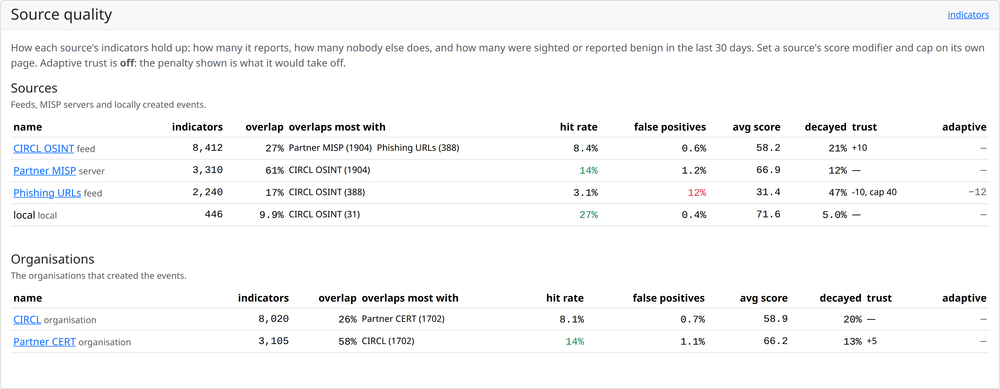
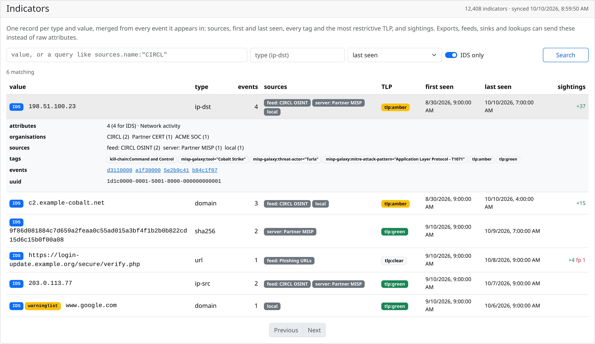
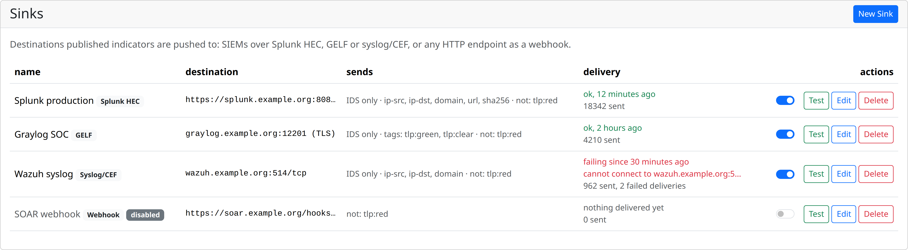

<!-- _class: dark title -->
<!-- _paginate: false -->

A MISP-compatible threat intelligence platform for ingesting, curating and sharing IOCs, built on OpenSearch.

<!--
One sentence to remember: everything MISP does with indicators, on a search engine, with the curation and sharing a SOC needs to actually use them. Five minutes, nine features.
-->

---

WHY ANOTHER PLATFORM

## MISP-compatible, rebuilt on a search engine

| | MISP | MISP Workbench |
|---|---|---|
| Backend | PHP · CakePHP | Python · FastAPI |
| Storage | MySQL / MariaDB | PostgreSQL + **OpenSearch** |
| Background jobs | background workers | Celery + Redis, scheduled with RedBeat |
| Frontend | server-rendered + jQuery | Vue 3 single-page app |

It still speaks MISP: syncs with MISP servers, reads MISP feeds, writes MISP JSON, and answers MISP's restSearch.

<!--
Not a fork and not a replacement for MISP communities: it sits next to them. The big change is the data store. Events, attributes, indicators and correlations all live in OpenSearch, so search, aggregation and ingest pipelines come for free.
-->

---

EXPLORE

## Lucene over everything

- One query, four tabs: **events**, **attributes**, **indicators**, **correlations**
- `type.keyword:ip* AND tlp:amber`
- `expanded.ip2geo.country_iso_code:RU`
- Time range and a timeline histogram
- Save any search as a **hunt** or an **export**

<!--
Explore is the front door. Anything indexed is searchable with Lucene, including enriched fields like GeoIP. A query that answers a question once can be kept: as a hunt that reruns it, or as an export that ships its results.
-->

---

HUNTS

## Saved searches that run on a schedule

| Type | Asks |
|---|---|
| **OpenSearch** | a Lucene query over events, attributes or correlations |
| **CPE** | CVEs affecting a product, via vulnerability.circl.lu |
| **Rulezet** | detection rules for a CVE, via rulezet.org |
| **MITRE ATT&CK** | what is tagged with these techniques |

Each run is kept, and new matches raise a notification.

<!--
Hunts turn a question into a watch. Two of the four types reach outside the platform: CPE asks CIRCL's vulnerability-lookup which CVEs hit a product you run, and Rulezet fetches the detection rules published for a CVE.
-->

---

<!-- _class: tight -->

INGEST

## Multiple sources and formats supported

- **MISP servers**: pull and push, with rules · **Feeds**: MISP, CSV, JSON (NDJSON, dot paths), freetext
- From a **URL on a schedule**, an **uploaded file**, the **REST API**, or a pasted report
- **CSV mapping**: type from a column with a mapping table, every property fixed or from a column, with a preview
- **Normalisation**: defanged values refanged, problems flagged, never dropped
- **Source quality**: hit rate, false positives and overlap per source, to set its trust

<!--
Source quality is the part people don't have elsewhere: for every feed, server and organisation, how often its values were actually hit, how often they were reported benign, and how much it overlaps with other sources. That's the evidence for trusting a feed, instead of its reputation.
-->

---

INDICATORS

## One record per indicator, with a score that decays

- Every attribute holding a value, merged: sources, TLP, sightings
- **Base** by source, **+5** per corroborating source
- **Sightings** add, **false positives** subtract
- **Warninglisted** −50 · **validation issue** −40
- **Decay**: halves every 30 days for IPs and URLs, 90 for domains, never for hashes

A C2 from two years ago fades out of block lists; a malware hash keeps its value.

<!--
The score is readable: every part shows in the breakdown, every number is a runtime setting, and each source has its own modifier and cap. Decay counts from last seen, and a positive sighting moves last seen, so what is still being hit stays alive.
-->

---

<!-- _class: tight -->

SHARE

## Every control gets its own format

- **Detection profiles**: say once what goes to a control; every output can use it
- **Exports**: MISP JSON, STIX 2.1, CSV, NDJSON incremental feeds, **Suricata**, **Zeek**, **DNS RPZ**, **Wazuh CDB**
- **Firewall lists**: PAN-OS, FortiGate, Check Point, Cisco, Squid
- **Sinks**: Splunk HEC, GELF, syslog/CEF, webhooks · Sentinel, Defender, Elastic *(beta)*
- **APIs**: `/lookup`, restSearch, streaming exports, an **MCP** server for AI assistants

<!--
The point: no conversion scripts. A firewall pulls its list, the IDS gets rules, the resolver gets a zone, the SIEM gets pushed events, all from the same profile, with an approval queue in front of what blocks traffic.
-->

---

CLOSE THE LOOP

## SIEM alerts come back as sightings

SIEM alert<b>→</b>Alert webhook<b>→</b>Sighting<b>→</b>Score<b>→</b>Next share

- Presets for **Splunk**, **Elastic / Kibana**, **Graylog**, **Wazuh**, **Microsoft Sentinel**, generic JSON
- No code on the sender's side: paste the URL into its webhook action
- A Sentinel incident closed as *False positive* reports a false positive
- **Hit-rate expiry** drops what no sensor has hit, so block lists shrink

<!--
This is the step most SOCs skip, and why their block lists only ever grow. A hit raises a value's score and keeps it alive; a false positive lowers it and can push it out of every profile.
-->

---

TECH LAB

## Analyse, automate, transform

<h3>Analyst notebooks</h3>
Python with the <code>mwlab</code> SDK: retro-hunts, campaign reports, source reviews. Rerun, share, export to PDF.

<h3>Reactor scripts</h3>
Python that runs when an event is published, an attribute created or a sighting arrives: tag, enrich, forward. Sandboxed, with a write quota.

<h3>Transformation servos</h3>
Your own OpenSearch ingest pipelines, on every attribute as it is indexed: parse, normalise, enrich.

<!--
Notebooks are the pull side: an analyst asks. Reactor scripts are the push side: the platform reacts. Servos act before any of it, as data is indexed. Everything they do is audited under the user's identity.
-->

---

<!-- _class: dark -->
<!-- _paginate: false -->

TRY IT

## Docs, and a hands-on workshop on Friday

**misp-workbench.readthedocs.io**

**From Feed to Firewall** · Friday 23 October · 10:15 · Hollenfels

90 minutes, hands-on: ingest, curate and share IOCs with a firewall, an IDS, a DNS resolver and a SIEM.

Bring a laptop with Docker · github.com/MISP/misp-workbench

<!--
Leave this up during questions. The QR code opens the documentation. Friday's workshop builds the whole pipeline from this talk on the attendees' own machines: bring a laptop with Docker, and run the setup in the guide before the session if you can.
-->
