# misp-workbench — Workshop: From Feed to Firewall

A 90-minute, hands-on workshop on getting indicators of compromise (IOCs) **into** misp-workbench, **curating** them until they are safe to act on, and **sharing** them with the security products a SOC runs: firewalls, IDS, DNS resolvers and SIEMs. It ends by closing the loop: detections come back as sightings and change what is shared next.

By the end you will have:

1. **Ingested** a blocklist feed and an incident report, and seen how normalisation cleans them.
2. Read an indicator's **confidence score** and set a feed's **trust**.
3. Protected your own infrastructure with an **organisation warninglist**.
4. Built a **detection profile** for perimeter blocking, with a human **approval** step.
5. Fed four controls from that one profile: a **Palo Alto EDL**, **Suricata** rules, a **DNS RPZ** zone and a live **Wazuh** manager.
6. Turned a **Wazuh alert** into a **sighting** through a webhook, and watched it change the score.
7. *(Bonus)* Retro-hunted the campaign in an **analyst notebook**, and tagged its infrastructure on arrival with a **reactor script**.

> **Scenario.** You are on the SOC team at *ACME Bank*. A phishing campaign is targeting the treasury team. Threat intel arrives from an unverified blocklist someone found on a paste site, and from a vendor report your analyst just read. By the end of the session you must block confirmed command-and-control (C2) infrastructure at the perimeter, sink phishing domains in DNS, give the IDS rules for the campaign and alert in the SIEM. You must **not** block Google DNS, a Tor exit your users rely on, or ACME's own VPN.

The slides that go with this guide follow the same order. The pre-session setup (section 0) is not part of the 90 minutes.

| Time | Module | Lab |
|---|---|---|
| 0:00 | Intro: the SOC problem, the pipeline, the scenario | — |
| 0:10 | **1. Ingest** | Lab 1, 15 min |
| 0:30 | **2. Curate** | Lab 2, 15 min |
| 0:55 | **3. Share** | Lab 3, 20 min |
| 1:20 | **4. Close the loop** | Lab 4, 5 min |
| 1:25 | Wrap-up and questions | — |
| *+20 min* | ***5. Bonus: analyse and automate*** | *Lab 5: a notebook and a reactor script* |

Each lab has **must-do** steps and **if you have time** steps. If you fall behind, skip the latter; the next lab doesn't depend on them.

---

## 0. Before you start

Do this **before** the session: the demo seed takes a few minutes.

### Start the stack and load the demo data

From the repo root:

```bash
cp .env.dev.dist .env.dev          # set OPENSEARCH_INITIAL_ADMIN_PASSWORD at minimum
cp frontend/.env.dist frontend/.env
docker compose -f docker-compose.yml -f docker-compose.dev.yml --env-file=".env.dev" up --build
```

When the stack is up, seed the walkthrough dataset. It is additive and safe to run twice:

```bash
docker compose exec api poetry run python -m app.cli seed-demo
```

It loads all MISP warninglists (about two minutes; don't skip them, Lab 2 needs them), events with overlapping indicators, sightings, and disabled sample feeds, servers and sinks. It does **not** fetch any live feed, which would bury the curated data under thousands of unrelated values.

Open **http://localhost:3000/login** and sign in as `admin@admin.test` / `admin`. The API is at **http://localhost:8080** (its reference at http://localhost:8080/docs).

### A Wazuh manager

In Lab 3c a **live Wazuh manager** (4.x) pulls the curated list and alerts on it. Have one ready, with a root shell on it, that can reach the misp-workbench API on port 8080. A single-node Wazuh install, or Wazuh's Docker deployment, is enough. Without one, follow Lab 3c on the projector: the steps are the same.

### The navigation

The top bar groups pages by task. This workshop uses four of the menus:

| Menu | What we use |
|---|---|
| **Ingest** | Feeds, Alert webhooks |
| **Intel** | Indicators, Review queue, Warninglists |
| **Share** | Detection profiles, Exports, Sinks, External dynamic lists |
| **Admin** | Runtime settings (scoring), Tasks |

Press **Ctrl+K** (⌘K on a Mac) anywhere to jump to a page, or paste a value to search it.

### Create an API key

Account menu (top right) → **My API keys** → **New API key**:

| Field | Value |
|---|---|
| **Name** | `workshop` |
| **Scopes** | Click **SIEM integration preset** |

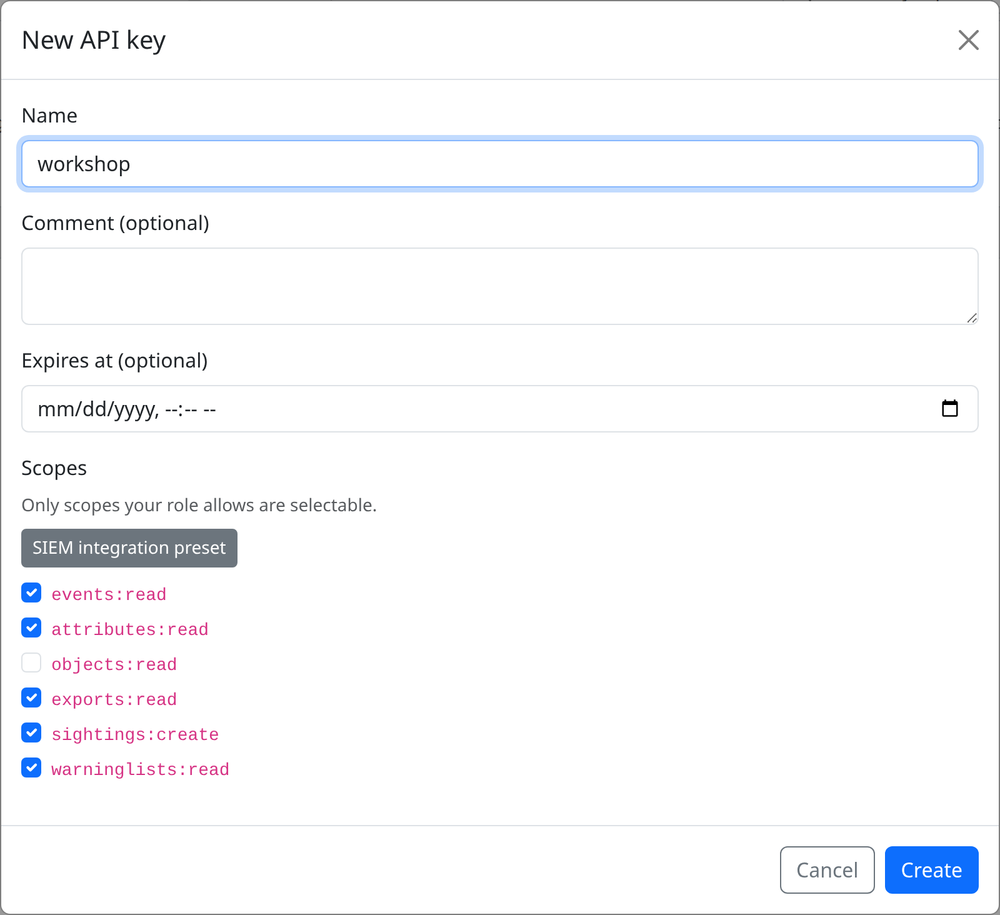

The preset grants `events:read`, `attributes:read`, `exports:read`, `sightings:create` and `warninglists:read`: what a SIEM needs, and all this workshop's API calls need. The key is **shown once**. Keep it in your shell:

```bash
export API=http://localhost:8080
export KEY=<your 40-character key>
```

### The lab files

Create a folder `workshop/` and save these two files in it.

**`c2-blocklist.txt`** is the unverified blocklist from the paste site. It is defanged, has a duplicate, and contains a value that must never be blocked:

```text
# C2 list found on a paste site, 2026-10-14. Unverified.
c2.example-cobalt[.]net
beacon-relay.example-cobalt[.]net
stage.example-cobalt.net
hxxp://update-service[.]test/agent/setup.exe
185.220.101[.]42
185.220.101.42
8.8.8.8
```

**`vendor-report.txt`** holds the IOCs from the vendor report your analyst read. Like most reports, it mixes the attacker's infrastructure with the victim's (`10.20.30.40` is the treasury workstation):

```text
c2.example-cobalt[.]net
invoice-portal[.]test
hxxps://invoice-portal[.]test/download/48812
billing@invoice-portal[.]test
hxxp://update-service[.]test/agent/setup.exe
9f2b8c1d4e5a67380b1c2d3e4f5a6b7c8d9e0f1a2b3c4d5e6f708192a3b4c5d6
185.220.101[.]42
10.20.30.40
```

---

## 1. Ingest

**Goal:** bring both sources in, and see them arrive in one clean shape.

misp-workbench takes intelligence in three main ways:

| Source | SOC use case | Where |
|---|---|---|
| **Feeds** | Daily OSINT blocklists (abuse.ch, CIRCL OSINT) | **Ingest → Feeds**: MISP, CSV, JSON or freetext, fetched from a URL or uploaded |
| **MISP servers** | Curated events from your ISAC or a partner CERT | **Ingest → MISP servers**, with pull rules (see [tutorial.md](tutorial.md#1-connect-a-remote-misp-server)) |
| **Batch import** | The report an analyst just read | An event → **Import Data** |

Whatever the path, every value is **normalised** as it is written. Defanged values are refanged (`hxxps://evil[.]com` → `https://evil.com`), hostnames and hashes are lower-cased, and IPs are made canonical. The value as received is kept, and problems are **flagged, never dropped**.

### Lab 1a — Upload the blocklist as an offline feed

Feeds normally fetch from a URL on a schedule. A feed can also be fed from a **file you upload**: an IOC list that arrived by email or chat, an export from an air-gapped network, or, as here, a lab that has to work without internet. Every feed format accepts uploads: freetext (`.txt`, `.csv`), CSV (`.csv`, `.txt`), JSON (`.json`, `.ndjson`), and MISP feeds packed as a `.zip` or `.tar.gz` with `manifest.json` at the root.

**1. Pick the format.** Go to **Ingest → Feeds** → **+ Add Feed** and choose the **Freetext Format** card: the paste-site list has one indicator per line.

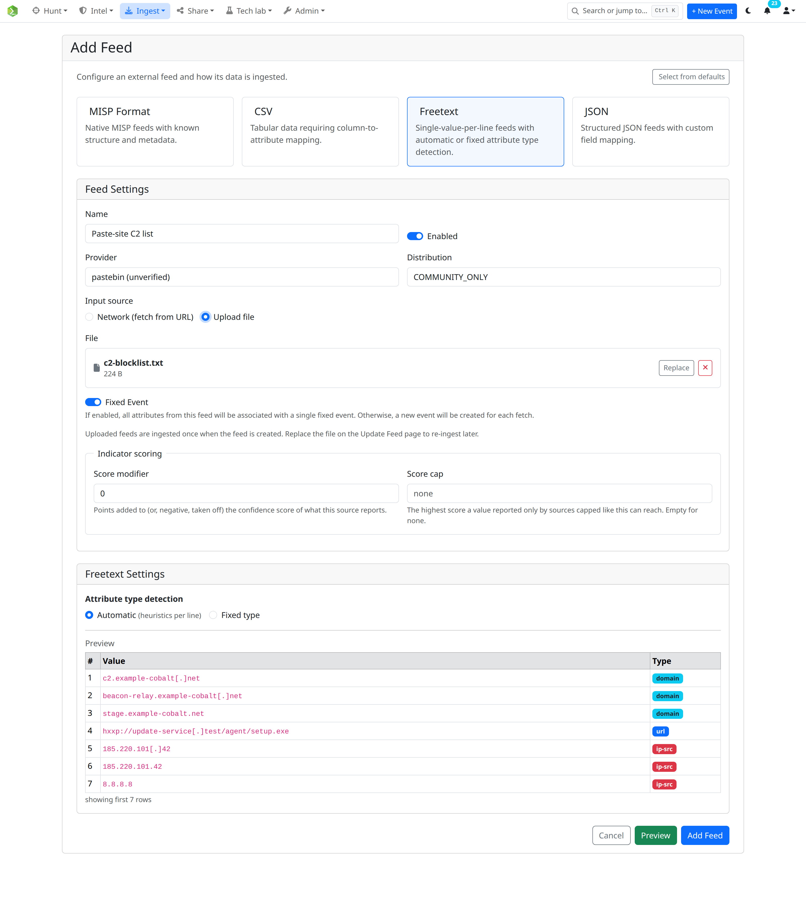

**2. Switch the input source to a file.** In **Feed Settings**, set **Input source** to **Upload file**. The **URI** field turns into a **File** dropzone: click *Click to select or drop a file here* and pick `workshop/c2-blocklist.txt`, or drag it in. The **Update interval** and fetch-immediately controls disappear, because an uploaded feed has nothing to fetch on a schedule.

| Field | Value | Notes |
|---|---|---|
| **Name** | `Paste-site C2 list` | |
| **Provider** | `pastebin (unverified)` | Becomes the indicator's source name |
| **Input source** | **Upload file** | The file is stored in misp-workbench (up to 2 GB) |
| **File** | `c2-blocklist.txt` | |
| **Fixed Event** | on | Every ingestion of this feed lands in one event |

**3. Tell it how to read the lines.** In **Freetext Settings**, set **Attribute type detection** to automatic (heuristics per line). Each line's type is then guessed (IP, URL, email, hash, domain…); lines starting with `#` and blank lines are skipped. Choose **Fixed type** instead when a file holds one kind of value only, say a list of IPs.

**4. Preview before you ingest.** Click **Preview**. The **Freetext Feed Preview** shows every parsed line with its detected type, read from the file you uploaded. Check that:

- `c2.example-cobalt[.]net` was read as a **domain**: defanged values are recognised;
- `hxxp://update-service[.]test/…` was read as a **url**;
- the comment line on top is gone.

**5. Create it.** Click **Add Feed**. Creating an upload feed ingests the file **once**: the job runs in the background (watch it under **Admin → Tasks**) and takes a few seconds for a file this size.

**6. Check it arrived.** In **Hunt → Explore**, search `value:"beacon-relay.example-cobalt.net"`: the attribute is there, in the feed's event, with **Provider** as its source.

> **One-shot by design.** An uploaded feed never runs on a schedule, and re-uploading doesn't re-ingest what was ingested before. When the paste site posts a new version, open the feed's edit page, click **Replace** next to the file name, pick the new file and **Save**, then click **Fetch** (the download icon) in the feed list to ingest it.

> **On a live instance** the same feed would use **Network (fetch from URL)** with a real source, for example abuse.ch's URLhaus, and an **Update interval** of **Daily**. We upload here so the lab works offline, and so a live feed doesn't bury the demo data under thousands of unrelated values.

If you prefer the API, an upload feed takes two calls: upload the file, then create the feed with the returned `key` as its URL. Both need the `feeds:create` scope, which the SIEM preset doesn't grant, so create a second key with it (**My API keys**, scope `feeds:create`):

```bash
export FEEDS_KEY=<a key with feeds:create>
curl -s -X POST "$API/feeds/upload" -H "Authorization: $FEEDS_KEY" \
  -F file=@workshop/c2-blocklist.txt -F source_format=freetext
# → {"key": "feed-uploads/<uuid>", "filename": "c2-blocklist.txt", ...}
```

The returned `key` goes in `url` when you `POST /feeds/` with `"input_source": "local"`; see [feeds/local-files.md](../docs/features/feeds/local-files.md).

### Lab 1b — Import the vendor report

1. Click **+ New Event** (top right). Set **info** to `Phishing: ACME treasury`, threat level **High**, and **Create**.
2. On the event, click **Import Data** and paste the contents of `vendor-report.txt`.
3. Check the summary bar: the **Detected types** badges should show a domain, URLs, an email, a sha256, and IPs. Per-line **type** and **category** dropdowns let you correct a guess.
4. Click **Import**.

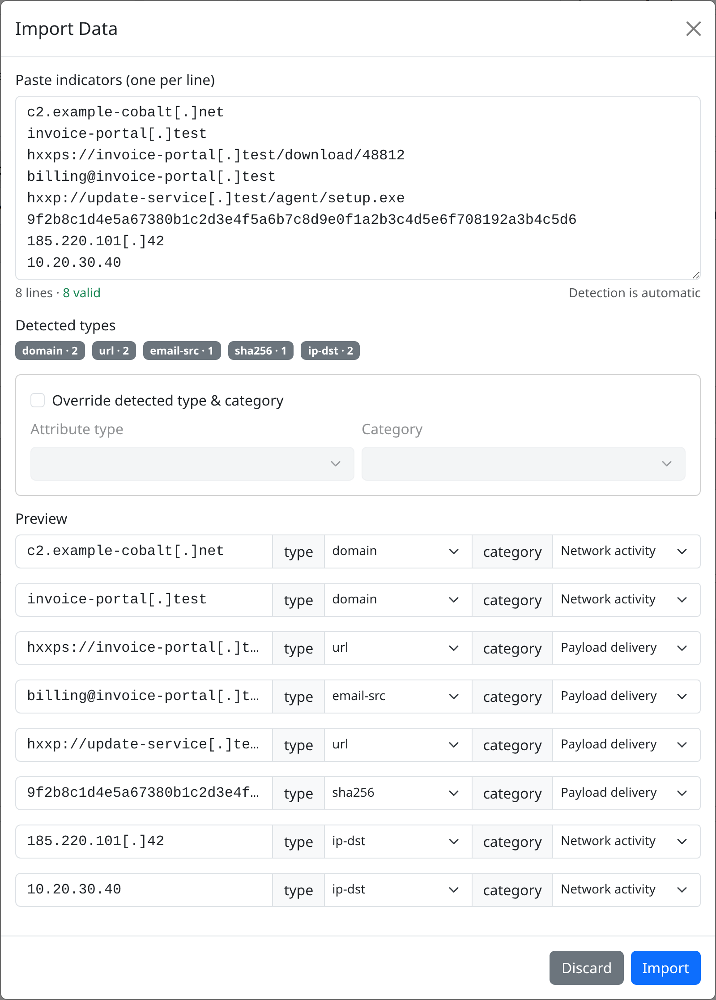

### Lab 1c — See what normalisation did

Open the event's **Attributes** tab. Values that were defanged carry a **normalised** badge: hover it to see the original.

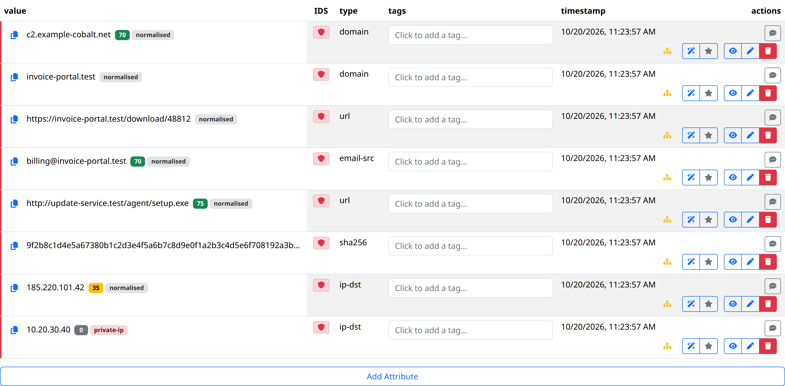

Then go to **Hunt → Explore** and run these queries:

| Query | Finds |
|---|---|
| `value:"185.220.101.42"` | One value, from the feed **and** the event, despite the defanging and the duplicate |
| `validation_issues:*` | `10.20.30.40`, flagged `private-ip`: the victim's workstation |
| `_exists_:warninglist_hits` | `8.8.8.8` and `185.220.101.42`, which sit on MISP warninglists |

**Check.** You can answer these:
- Why is `10.20.30.40` flagged and not deleted? (It is evidence for the investigation, but it must never reach a block list. Flagging lets curation keep it out.)
- Which warninglist is `185.220.101.42` on? Use **Intel → Warninglists → Check values**.

### If you have time

- Upload a **CSV** feed instead, with a header like `indicator,type,comment`. Set **Type strategy** to **Column** and map your type names onto MISP's. See [feeds/csv.md](../docs/features/feeds/csv.md).
- **Admin → Runtime settings → normalisation**: switch on **Strip tracking parameters** and see what it would do to a phishing URL with `utm_*` parameters.

---

## 2. Curate

**Goal:** decide which values are trustworthy and safe enough to block, and make a human approve the ones that will be.

### Indicators and their score

misp-workbench keeps one **indicator** per type and value, merging every attribute that holds it: its sources, first and last seen, the strictest TLP, sightings and warninglist hits. Each indicator gets a **confidence score** from 0 to 100, built from parts you can read:

| Part | Default |
|---|---|
| **Base**, by source | local 70 · MISP server 60 · feed 50 |
| **Corroboration** | +5 per further independent source, up to +15 |
| **Sightings** | +5 / +10 / +15 at 1 / 3 / 7+ |
| **False positives** | −20 each, down to −60 |
| **Warninglist** | −50 |
| **Validation issue** | −40 |
| **Decay** | the score halves every 30 days for IPs and URLs, 90 for domains, never for hashes, counted from last seen |

Every number is editable in **Admin → Runtime settings → scoring**. Below 30 an indicator counts as decayed.

### Lab 2a — Read a score

Go to **Intel → Indicators** and search `value:*cobalt*`. Click **c2.example-cobalt.net** to open its details.

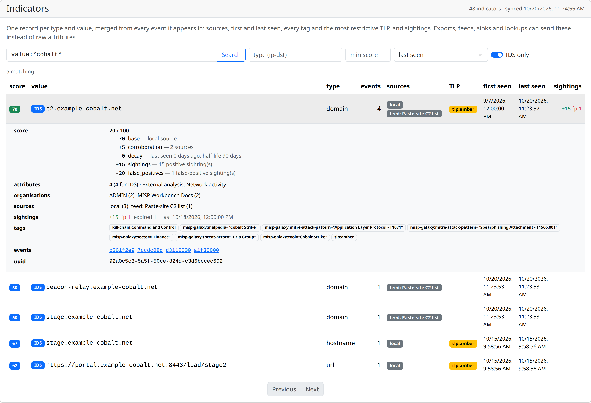

Read the score breakdown. The value comes from your event (local, base 70) **and** from the paste-site feed, so it gets a corroboration bonus. Now compare it with **beacon-relay.example-cobalt.net**, which only the feed reported.

### Lab 2b — Trust the feed for what it is

The paste-site list is unverified, so it shouldn't count as much as a vetted source. Go to **Ingest → Feeds**, edit **Paste-site C2 list**, and under **Indicator scoring** set:

| Field | Value | Effect |
|---|---|---|
| **Score modifier** | `-10` | Its values start at 40 instead of 50 |
| **Score cap** | `60` | A value only this feed reports never scores above 60 |

Save. The scores update within a minute or so. **beacon-relay** drops, while **c2.example-cobalt.net** keeps its higher score because your own event reports it too.

> **Real life.** **Intel → Source quality** shows, per feed and server, how many of its indicators were ever hit by a sighting, how many were reported false positives, and how many have decayed. Use that evidence, not reputation, to set trust.

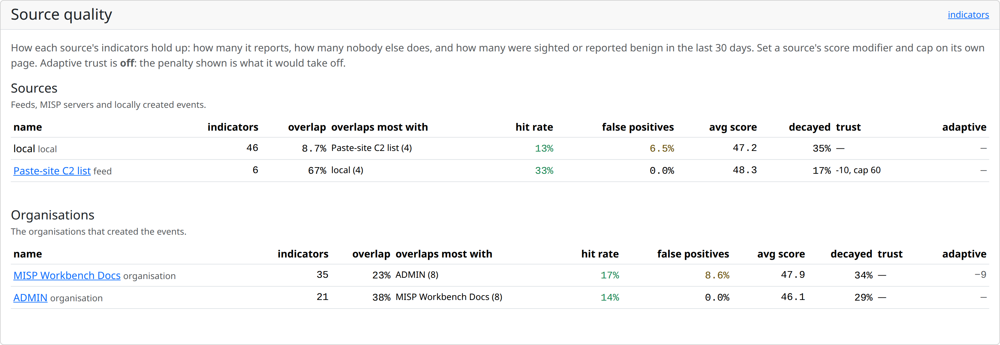

### Lab 2c — Protect your own infrastructure

MISP warninglists already cover the public: resolvers, top sites, cloud and CDN ranges, Tor exits. Your own infrastructure needs your own list.

Go to **Intel → Warninglists**, scroll to **Your organisation's lists** and click **+ New list**:

| Field | Value |
|---|---|
| **Name** | `ACME own infrastructure` |
| **Description** | `Egress, VPN and corporate domains. Never block.` |

Open the list and add its entries, one per line (**Import** takes the same `entry # comment` format):

```text
203.0.113.0/24     # VPN egress
198.51.100.10      # mail relay
*.acme-bank.test   # corporate domains
```

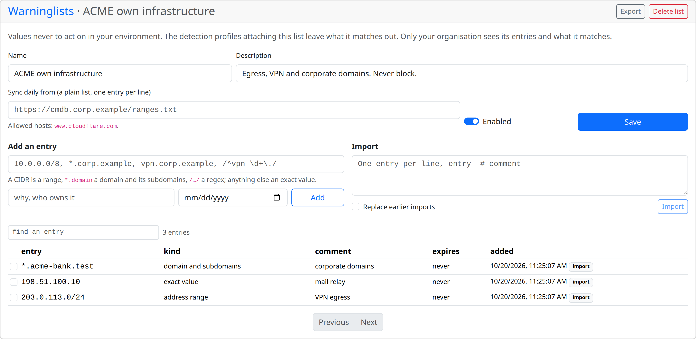

An organisation list is **private** and only applies to the profiles that attach it, which you do next.

### Lab 2d — A detection profile for perimeter blocking

A **detection profile** says once what goes to a control, and every output (EDLs, exports, sinks, lookups) can use it. Two are built in: **SIEM alerting** and **Firewall block list**. Build one for this campaign.

Go to **Share → Detection profiles** → **New**, name it `Perimeter block`, and set the rules:

| Rule | Value | Why |
|---|---|---|
| **Types** | `ip-src`, `ip-dst`, `domain`, `hostname`, `url` | What a firewall can act on |
| **Only flagged for IDS** | on | Analysts marked them as detection-worthy |
| **Minimum score** | `60` | Corroborated or vetted values only |
| **Last seen within** | `30` days | No stale infrastructure |
| **TLP ceiling** | `amber` | Nothing `tlp:red` leaves the SOC |
| **Leave out warninglisted** | on | Google DNS, Tor exits, CDNs |
| **Leave out validation issues** | on | No private or malformed values |
| **Organisation warninglists** | `ACME own infrastructure` | Never your own ranges |
| **Require approval** | on | A human signs off each value |

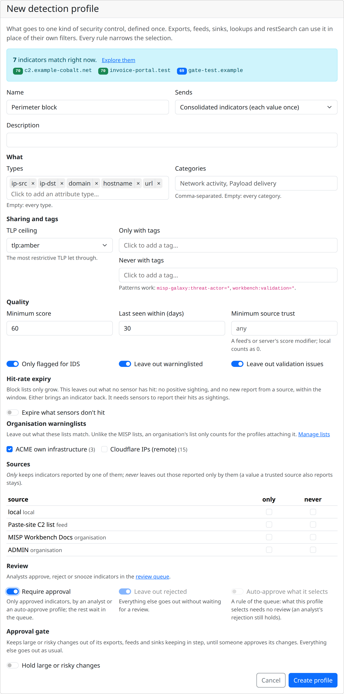

The editor shows a **live match count** and samples as you change rules. Watch `8.8.8.8`, `185.220.101.42`, `10.20.30.40` and `beacon-relay…` fall out. Save.

Open the profile's **Changes** page. It shows what its next run would add and remove, by type, source and reason, with **risk flags**: popular sites, shared hosting or cloud ranges, values from a brand-new source.

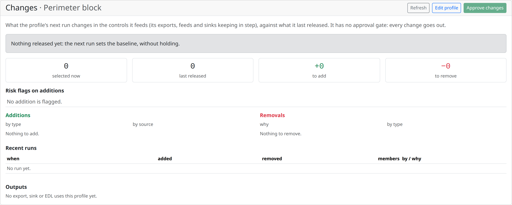

> **Real life.** For a blocking profile, turn on **Hold large or risky changes** too. A partner who suddenly shares 40,000 values, or a cloud range that slipped into a feed, then waits for approval instead of landing on the firewall at 3 a.m.

### Lab 2e — Approve what goes out

Because the profile **requires approval**, nothing reaches a control yet. Go to **Intel → Review queue** and pick **Perimeter block** in the profile filter.

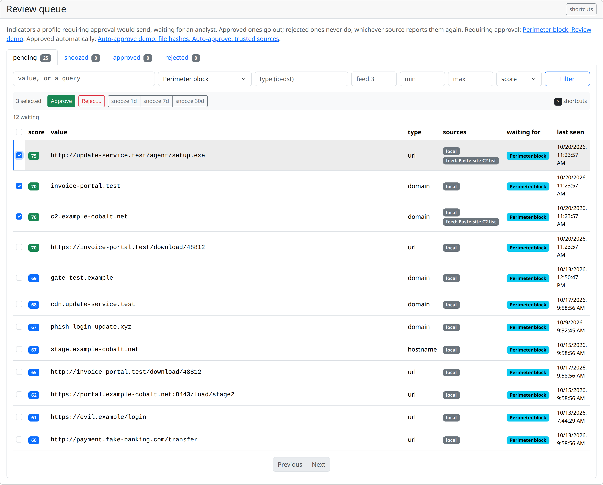

Each row has its score breakdown, sources, sightings and warninglist hits. Click a row for the full context. Then:

1. **Approve** `c2.example-cobalt.net`, `invoice-portal.test` and the `update-service.test` URL (keyboard: `a`).
2. **Reject…** one value you don't trust, giving a reason (`r`). Tick **Also add to the *Rejected in review* warninglist**, so the rejection applies everywhere, not just to this profile.
3. **Snooze** another for 7 days (`s`): it comes back to pending then.

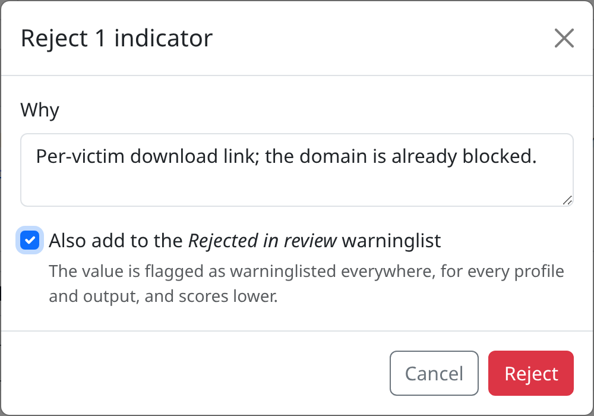

**Check.**
- The profile now holds only what you approved, and `8.8.8.8` is not among it.
- Your rejected value shows up on the **Rejected in review** list (**Intel → Warninglists**).

> **Real life.** Reviewing every value doesn't scale. Pair the approval rule with an **auto-approve** profile for sources you trust. One is built in, **Auto-approve: trusted sources** (IDS, score ≥ 70, from a feed or server with a score modifier of at least +10, clean), so analysts only review the long tail.

### If you have time

- Add **Hit-rate expiry** to the profile: a value leaves after a window with no positive sighting and no new report. Combined with Lab 4, this is what keeps block lists from growing forever.
- **Admin → Runtime settings → scoring**: change the domain half-life and watch the scores move.

---

## 3. Share

**Goal:** give four controls the same approved values, each in its own format, with no conversion script.

| Control | Gets | Where |
|---|---|---|
| **Firewall** | A list it fetches every few minutes | **Share → External dynamic lists** |
| **IDS** | Suricata rules or a Zeek Intel file | **Share → Exports**, format `suricata` or `zeek` |
| **DNS resolver** | A Response Policy Zone | **Share → Exports**, format `rpz` |
| **SIEM** | An IOC list its rules look up, pushed events, or a feed to poll | Wazuh CDB lists (format `cdb`); **Share → Sinks** (Splunk HEC, GELF, syslog/CEF, webhook); incremental feeds |
| **EDR, cloud SIEM** | Vendor indicators via API | Sinks: Sentinel, Defender, Elastic *(beta)* |
| **SOAR, scripts** | "Is this value known?" | `POST /lookup`, restSearch, streaming exports |

All of them can take the **Perimeter block** profile, so the firewall, the resolver and the IDS agree on what is malicious. Safety nets are built in: firewall lists and IDS/DNS formats never write networks broader than a /16, special-purpose addresses, or public suffixes like `co.uk`.

### Lab 3a — A Palo Alto external dynamic list

Go to **Share → External dynamic lists** and create a list:

| Field | Value |
|---|---|
| **Name** | `Perimeter block: domains` |
| **Detection profile** | `Perimeter block` |
| **Vendor** | Palo Alto PAN-OS |
| **Holds** | domains |
| **Rebuilt every (minutes)** | `15` |

Leave **Subdomains too** off: it is greyed out for PAN-OS, which covers subdomains with the list's own setting instead (below).

Open the list. Its preview shows the entries **as served**. Under **Tokens**, create one for the firewall: **Token name** `fw-edge-01`, and in production **Only from** the firewall's management IP. The URL is **shown once**; copy it, then fetch it as the firewall would:

```bash
curl -s http://localhost:8080/edl/<token>
```

You get the domains you approved in Lab 2, one per line. On a real PAN-OS: **Objects → External Dynamic Lists → Add**, type *Domain List*, source the URL, tick **Automatically expand to include subdomains**, repeat *Five Minute*, **Test Source URL**, then use the list in a security policy and commit.

> Each firewall gets its own token, so revoking one doesn't break the others. Every fetch is audited (`edl.fetched`).

### Lab 3b — Suricata rules and a DNS RPZ zone

Go to **Share → Exports** → **+ New Export**:

| Field | Suricata export | RPZ export |
|---|---|---|
| **Name** | `ids-perimeter-block` | `dns-firewall` |
| **Detection profile** | `Perimeter block` | `Perimeter block` |
| **Lucene Query** | `*` | `*` |
| **Format** | **Suricata rules** | **DNS RPZ zone** |
| **Format options** | **Rule action**: `alert` | **Answer**: *Walled garden (CNAME)* → `blocked.acme-bank.test` |
| **Run on a schedule** | **Hourly** | **Hourly** |

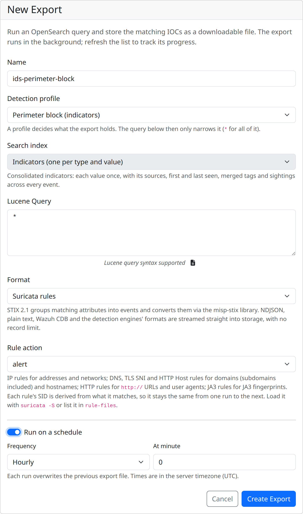

Create both and **Download** them when they complete. Look inside:

- **Suricata:** each domain gets DNS, TLS SNI and HTTP Host rules covering its subdomains, each with a **stable SID** derived from what it matches (suppressions keep working) and metadata with the indicator's uuid, score and source. The `https://` URL gets no rule, because its path is encrypted where a sensor can't see it.
- **RPZ:** each domain becomes `name` and `*.name` records answered with your walled garden, under a serial that increases with every run.

If you have the tools, load them as the engines would:

```bash
suricata -T -c /etc/suricata/suricata.yaml -S "$PWD/ids-perimeter-block.rules"
docker run --rm -v "$PWD":/d:ro --entrypoint named-checkzone \
  internetsystemsconsortium/bind9:9.20 rpz.local /d/dns-firewall.rpz
```

The same output is available without storing a file, straight from the API:

```bash
curl -s -H "Authorization: $KEY" "$API/indicators/export?format=suricata&profile=Perimeter%20block"
```

### Lab 3c — Wazuh: match your logs against the profile

Wazuh matches log fields against IOC lists in its own format, **CDB lists** (`key:value`, one per line), and raises an alert on a hit. misp-workbench writes the **Perimeter block** profile in that format (`cdb`), so the Wazuh manager pulls the list straight from the API and a rule looks values up in it. No script converts anything, and the list holds only what you approved in Lab 2.

You need a **live Wazuh manager** (4.x) that can reach the misp-workbench API, and a shell on it (as root). From the manager, `localhost` is not misp-workbench: use the address of the machine running the stack.

**1. Pull the profile as a CDB list.** On the Wazuh manager:

```bash
export WB_API=http://<workbench-host>:8080      # as seen from the Wazuh manager
export KEY=<your SIEM-preset API key>
curl -fsS -H "Authorization: $KEY" \
  "$WB_API/indicators/export?format=cdb&profile=Perimeter%20block" \
  -o /var/ossec/etc/lists/misp-perimeter
chown wazuh:wazuh /var/ossec/etc/lists/misp-perimeter
cat /var/ossec/etc/lists/misp-perimeter
```

You get one approved value per line, with its type as the CDB value. Keys containing `:` (URLs, IPv6) are quoted, as Wazuh expects:

```text
c2.example-cobalt.net:domain
"http://update-service.test/agent/setup.exe":url
invoice-portal.test:domain
```

`8.8.8.8`, `185.220.101.42`, `10.20.30.40` and anything you didn't approve are not there. The streaming export reads the profile live, so the list is current every time you pull it.

**2. Load the list.** In `/var/ossec/etc/ossec.conf`, add the list to the `<ruleset>` section, next to the lists already there:

```xml
<ruleset>
  <!-- ... the existing <decoder_dir>, <rule_dir> and <list> entries ... -->
  <list>etc/lists/misp-perimeter</list>
</ruleset>
```

**3. Add a rule that looks values up in it.** In `/var/ossec/etc/rules/local_rules.xml`:

```xml
<group name="misp,threat_intel,">
  <rule id="100900" level="12">
    <decoded_as>json</decoded_as>
    <list field="url" lookup="match_key">etc/lists/misp-perimeter</list>
    <description>misp-workbench: $(url) is on the Perimeter block profile</description>
  </rule>
</group>
```

The rule fires when a JSON log's `url` field is a key of the list. In production you would write one rule per log source and field: `data.dns.question.name` for DNS logs, `data.url` for a proxy, `srcip` / `dstip` with `lookup="address_match_key"` for firewall logs.

Restart the manager so it compiles and loads the list:

```bash
systemctl restart wazuh-manager
```

**4. Test it.** Run `/var/ossec/bin/wazuh-logtest` and paste two proxy-log lines, one at a time:

```json
{"lab": "proxy", "srcip": "10.20.30.40", "url": "c2.example-cobalt.net"}
{"lab": "proxy", "srcip": "10.20.30.41", "url": "dns.google"}
```

The first ends in **rule 100900, level 12**, `misp-workbench: c2.example-cobalt.net is on the Perimeter block profile`. The second matches no rule of yours: Google's resolver was never on the list.

**5. See a real alert (if you have time).** Make an agent (or the manager itself) read a JSON log file, by adding to its `ossec.conf` and restarting it:

```xml
<localfile>
  <log_format>json</log_format>
  <location>/var/log/lab-proxy.json</location>
</localfile>
```

Then append the first line to `/var/log/lab-proxy.json`. The alert shows up in the Wazuh dashboard under **Threat Hunting**; filter on `rule.id:100900`.

**6. Keep it current.** Schedule the pull so the list follows the profile. A root crontab entry that refreshes it every 15 minutes:

```cron
*/15 * * * * curl -fsS -H "Authorization: <key>" "<workbench>/indicators/export?format=cdb&profile=Perimeter%20block" -o /var/ossec/etc/lists/misp-perimeter.new && mv /var/ossec/etc/lists/misp-perimeter.new /var/ossec/etc/lists/misp-perimeter && systemctl restart wazuh-manager
```

Downloading to a temporary file first means a failed pull never leaves Wazuh with an empty list.

> **Real life.** Instead of the streaming endpoint, you can also create a scheduled **Wazuh CDB list** export in **Share → Exports** and download its stored file (`GET /exports/{id}/download`, answered `304` when nothing changed). Wazuh can also be **pushed to**: a **Syslog / CEF** sink sends each published event's indicators to the manager's syslog port. And it reports back: in Lab 4 its alerts become sightings. For Splunk there is an HEC sink; for Microsoft Sentinel, Defender for Endpoint and Elastic Security there are vendor API sinks (beta).

### If you have time — "is this value known?"

A SOAR playbook triaging an alert asks one question: are any of these values known, and how confident are we?

```bash
curl -s -X POST "$API/lookup" -H "Authorization: $KEY" -H "Content-Type: application/json" \
  -d '{"values": ["c2.example-cobalt.net", "8.8.8.8", "10.20.30.40", "unknown.example"], "include_indicators": true}'
```

`c2.example-cobalt.net` and `10.20.30.40` come back, the latter with its `private-ip` validation issue; `8.8.8.8` is left out because it is warninglisted, and the last value is unknown. Add `"profile": "Perimeter block"` to ask "would we block it?" instead: then only the approved C2 domain comes back.

---

## 4. Close the loop

**Goal:** turn a detection in the SIEM into a sighting, and see it change the score.

Sightings are the feedback loop. A positive sighting raises a value's score and keeps it alive under hit-rate expiry; a false positive lowers it, and can drop it out of a profile. **Alert webhooks** take SIEM and SOAR alerts in their own shape, so no custom code is needed on the sender's side.

### Lab 4 — Wazuh reports its hits back

In Lab 3c, Wazuh learned the campaign's values and alerts when a log matches one (rule 100900). Now Wazuh posts those alerts back to misp-workbench, where each one becomes a **sighting** of the values it hit.

**1. Create the webhook.** Go to **Ingest → Alert webhooks** → **+ New webhook**:

| Field | Value | Notes |
|---|---|---|
| **Name** | `Wazuh: perimeter hits` | |
| **Sender** | **Wazuh integration** | Its mapping reads the alert's `data` and `syscheck` indicator fields, and uses `rule.description` as the sighting's source |
| **Only values an attribute holds** | on | Values nobody reported (other internal hosts) are ignored |
| **Only from** | the Wazuh manager's address | Requests from anywhere else get `403` |

Create it and copy the URL from the green box: it is **shown once**, and the token in it is the only credential (Wazuh's integrations send no `Authorization` header). The webhook's page shows the setup for this sender.

**2. Point a Wazuh integration at it.** On the Wazuh manager, add to `/var/ossec/etc/ossec.conf`:

```xml
<integration>
  <name>shuffle</name>
  <hook_url>http://<workbench-host>:8080/webhooks/alerts/awh_…</hook_url>
  <rule_id>100900</rule_id>
  <alert_format>json</alert_format>
</integration>
```

`shuffle` is an integration Wazuh ships that posts each matching alert as JSON to any URL, wrapped in an `all_fields` object; the preset reads it wrapped or not. `<rule_id>` sends only rule 100900's alerts; use `<level>` instead to send everything above a severity. Then restart:

```bash
systemctl restart wazuh-manager
```

**3. Make Wazuh see the C2.** `wazuh-logtest` doesn't raise real alerts, so this needs the log file from Lab 3c step 5. If you skipped it, add that `<localfile>` now and restart. Then simulate the treasury workstation reaching the C2 through the proxy:

```bash
echo '{"lab": "proxy", "srcip": "10.20.30.40", "url": "c2.example-cobalt.net"}' >> /var/log/lab-proxy.json
```

Wazuh raises rule 100900, and the integration posts the alert to the webhook.

**4. Check it came back.**

- **Ingest → Alert webhooks → Wazuh: perimeter hits**: 1 request, the time it arrived, and the address it came from.
- Click **Last received** to load the alert Wazuh actually sent into **Try it**, then **Read it**: the mapping reads `c2.example-cobalt.net` and `10.20.30.40` from its `data` fields, with the rule's description as source.
- **Intel → Indicators → c2.example-cobalt.net**: a new positive sighting, from *misp-workbench: c2.example-cobalt.net is on the Perimeter block profile*, and a higher score.

> **No Wazuh in the room?** Post the same alert yourself, in the shape Wazuh's integration sends:
>
> ```bash
> export WEBHOOK='http://localhost:8080/webhooks/alerts/awh_…'
> curl -s -XPOST "$WEBHOOK" -H 'Content-Type: application/json' -d '{
>   "rule_id": "100900",
>   "all_fields": {
>     "timestamp": "'"$(date -u +%Y-%m-%dT%H:%M:%S.000+0000)"'",
>     "rule": {"id": "100900", "level": 12,
>              "description": "misp-workbench: c2.example-cobalt.net is on the Perimeter block profile"},
>     "agent": {"id": "001", "name": "proxy-01"},
>     "data": {"srcip": "10.20.30.40", "url": "c2.example-cobalt.net"}
>   }
> }'
> # → {"records":1}
> ```

> **Discuss.** The treasury workstation `10.20.30.40` got a sighting too, because the vendor report put it in an attribute. Is that what you want? It is evidence that the host is compromised, but it is not an indicator to block, and the profile keeps it out of every control anyway (validation issue). With **Only values an attribute holds** off, every internal address in every alert would become a sighting instead.

The webhook answers only how many records it read (`{"records": 1}`), never which values are known, so whoever holds the token learns nothing about your intel. If Wazuh's posts don't arrive, look for the integration in the manager's log: `grep -i integrat /var/ossec/logs/ossec.log`. The webhook's page shows the last request it refused, and why.

### If you have time — a false positive

Wazuh reports hits, not verdicts. When an analyst closes the alert as benign, the SOAR (or the analyst) reports it as a false positive through the sightings API:

```bash
curl -s -X POST "$API/sightings/" -H "Authorization: $KEY" -H "Content-Type: application/json" \
  -d '[{"value": "c2.example-cobalt.net", "type": "false-positive", "observer": {"source": "soc-triage"}}]'
```

Open its indicator: −20. Then open the **Perimeter block** profile's **Changes** page: if the score fell below 60, it shows as a removal with reason `score`, and the EDL, rules and zone drop it on their next build.

## 5. Bonus — Analyse and automate (20 minutes)

**Goal:** answer an analyst's question with a notebook, and automate a curation step with a reactor script.

Run this module when the room has time left, or as a follow-up session. It reuses the event and values from Labs 1 and 2.

The **Tech lab** holds both tools:

| Tool | Runs | SOC use |
|---|---|---|
| **Notebooks** | When you run a cell | Ad-hoc analysis you can rerun and share: retro-hunts, campaign reports, source reviews |
| **Reactor scripts** | When something happens: an event is published, an attribute is created, a sighting arrives… | Small automations that would otherwise be a cron job or a tired analyst: tagging, enrichment, forwarding |

Notebooks are the *pull* side (you ask) and reactor scripts the *push* side (the platform reacts). Notebooks only read, apart from enrichment and sending to a sink; reactor scripts write within a quota. Everything both do is audited under your identity.

### Lab 5a — Notebook: has this campaign hit us before?

The vendor report gave you the campaign's infrastructure. Before anyone writes "new campaign" in the incident report, check where else those values already appear: in partner events, in old feeds, in past incidents.

Go to **Tech lab → Notebooks**. In the **Personal** section click **+** (New notebook), name it `Retro-hunt: ACME treasury`, and **Create**. Use **Add → Code** for each cell below and **Shift+Enter** to run it. `mwlab` is already bound to your identity.

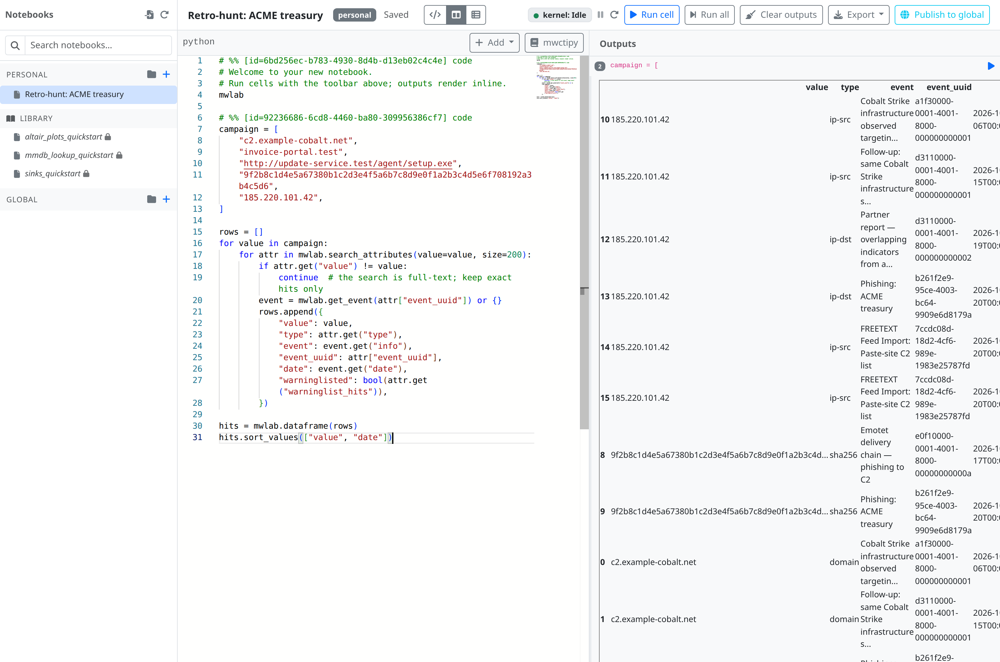

**Cell 1: where does each campaign value appear?**

```python
campaign = [
    "c2.example-cobalt.net",
    "invoice-portal.test",
    "http://update-service.test/agent/setup.exe",
    "9f2b8c1d4e5a67380b1c2d3e4f5a6b7c8d9e0f1a2b3c4d5e6f708192a3b4c5d6",
    "185.220.101.42",
]

rows = []
for value in campaign:
    for attr in mwlab.search_attributes(value=value, size=200):
        if attr.get("value") != value:
            continue  # the search is full-text; keep exact hits only
        event = mwlab.get_event(attr["event_uuid"]) or {}
        rows.append({
            "value": value,
            "type": attr.get("type"),
            "event": event.get("info"),
            "event_uuid": attr["event_uuid"],
            "date": event.get("date"),
            "warninglisted": bool(attr.get("warninglist_hits")),
        })

hits = mwlab.dataframe(rows)
hits.sort_values(["value", "date"])
```

**Cell 2: which values are not new?**

```python
hits.groupby("value")["event_uuid"].nunique().sort_values(ascending=False)
```

A value that appears in more than one event has history: the campaign reuses infrastructure.

**Cell 3: which events share infrastructure with this one?**

```python
shared = hits.groupby(["event_uuid", "event"])["value"].nunique()
shared[shared >= 2].sort_values(ascending=False)
```

Events sharing two or more campaign values are probably the same actor. Open them from **Hunt → Explore** and read their tags and galaxies: that is your attribution lead.

**Cell 4: the story as a timeline.**

```python
from IPython.display import HTML
events = [mwlab.get_event(u) for u in hits["event_uuid"].unique()]
HTML(render.timeline([e for e in events if e]))
```

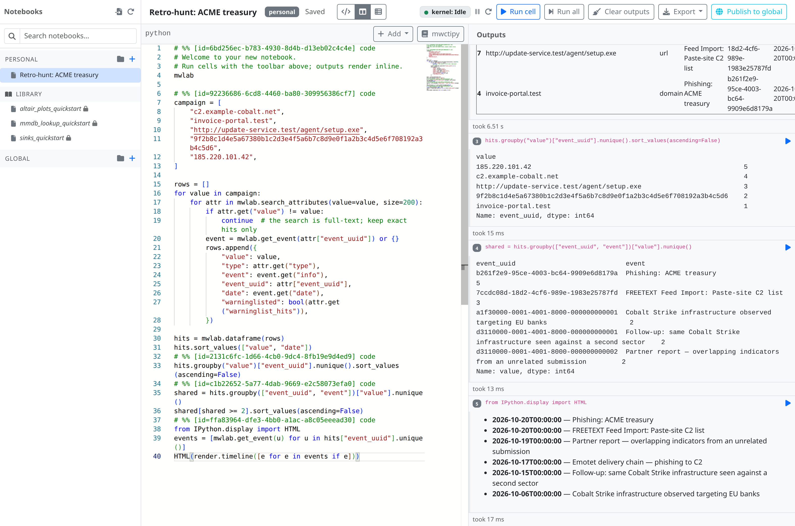

**Check.** You can say which campaign values were already known, since when, and from which events. With the seeded data, the Cobalt Strike infrastructure (`c2.example-cobalt.net`) and the Tor exit appear in earlier events too.

> **Real life.** Save the notebook, then **Publish to global** so the rest of the SOC can rerun it with the next campaign's values, or **Export** it as a PDF to attach to the incident ticket. A notebook can also enrich (`mwlab.enrich(value, type, module)`) and send its findings to a sink (`mwlab.send_to_sink(...)`), both audited.

### Lab 5b — Reactor script: tag campaign infrastructure on arrival

Lab 2 relied on analysts to recognise campaign infrastructure. A reactor script does it the moment a value arrives, from any source, so profiles, exports and Wazuh can route it by tag.

Go to **Tech lab → Reactor scripts** → **+ New Reactor Script**:

| Field | Value |
|---|---|
| **Name** | `Tag ACME treasury campaign infrastructure` |
| **Trigger** | resource `attribute`, action `created` |
| **Filters** | **Types**: `domain`, `hostname`, `url` |
| **Max writes / run** | `10` (the default) |

Replace the code with:

```python
# Infrastructure known to belong to the ACME treasury campaign.
CAMPAIGN_DOMAINS = ("example-cobalt.net", "invoice-portal.test", "update-service.test")
TAGS = (
    'misp-galaxy:tool="Cobalt Strike"',
    "kill-chain:Command and Control",
    'campaign:"acme-treasury"',
)


def handle(ctx, payload, trigger):
    value = (payload.get("value") or "").lower()
    hit = next((d for d in CAMPAIGN_DOMAINS if d in value), None)
    if hit is None:
        return
    for tag in TAGS:
        ctx.tag_attribute(payload["attribute_uuid"], tag)
    ctx.log("tagged", value, "as ACME treasury infrastructure (matched", hit + ")")
```

Each `tag_attribute` counts against the write quota: three per run, well under the 10 allowed. Tags that don't exist yet, like `campaign:"acme-treasury"`, are created.

**Test it without waiting for real data.** In the **Test sandbox**, pick the trigger, click **Load sample** → *attribute*, and edit the payload's `value` to `cdn.example-cobalt.net` and its `attribute_uuid` to the uuid of one of your event's domain attributes (copy it from the attribute's page). Click **Run**: the sandbox saves the script, runs it, and shows the status, the write count (3) and the log line. The sandbox writes for real: the attribute now carries the three tags.

**Then let it fire for real.** Open the event **Phishing: ACME treasury** → **Import Data**, paste one more value from the vendor's update, and **Import**:

```text
cdn.example-cobalt[.]net
```

Within seconds the script's **Run history** shows a successful run, and the new attribute carries the campaign tags.

**Check.**
- Search **Hunt → Explore** for `tags.name.keyword:"campaign:\"acme-treasury\""`: every campaign value is there, whichever source brought it.
- Edit the **Perimeter block** profile: **Only with tags** `campaign:*` would turn it into a campaign-specific block list.

> **Real life.** The same pattern covers most SOC glue: enrich new domains with passive DNS as they arrive (`ctx.enrich(...)`, counted against the quota), forward a trusted partner's IDS values to the SIEM at once instead of at publish (`ctx.send_to_sink(...)`), or react to a `sighting` trigger when Wazuh reports a hit. Every write is in the audit log as `reactor.write.<verb>`, under the script owner's identity.

---

## Wrap-up

What you built, as a checklist for your own SOC:

| ✅ | Practice | Lab |
|---|---|---|
| ☐ | Every feed has a **score modifier** that matches its track record (Source quality) | 2b |
| ☐ | Your own ranges and domains are on an **organisation warninglist** | 2c |
| ☐ | **One detection profile per control**, block lists stricter than alerting | 2d |
| ☐ | Blocking profiles **require approval** or **hold risky changes**, with auto-approve for trusted sources | 2d, 2e |
| ☐ | Controls **pull** (EDLs, exports, feeds) or are **pushed** to (sinks): no conversion scripts | 3 |
| ☐ | Alerts come back as **sightings**, and stale values **expire** (hit-rate expiry) | 4 |

### Clean up

On the Wazuh manager, remove the `misp-perimeter` list and the `shuffle` integration from `ossec.conf`, rule 100900 from `local_rules.xml`, the lab's `<localfile>` and the crontab entry, then restart it.

Delete the workshop's EDL tokens, exports, webhook, notebook and reactor script from their pages. To remove the demo data: `docker compose exec api poetry run python -m app.cli seed-demo --reset` (it removes only its own rows).

---

## Facilitator notes

- **Before the session.** Run section 0 on every machine, or on one shared instance with one user per attendee. Check that **Intel → Warninglists** lists the MISP lists; the seed loads them.
- **Timing.** Lab 2 is the longest and the one that matters most. If the room is slow, demo Lab 2b and 2c on the projector and let attendees do 2d and 2e.
- **Common snags.**
  - *The profile counts zero values to send.* Expected until values are approved in the review queue: that is the point of **Require approval**.
  - *A score didn't change.* Scores are rewritten when they move 5 points or more, and indicators sync every 15 seconds. Wait a moment and reload.
  - *The EDL is empty.* It is rebuilt on its schedule; use **Rebuild now** on its page.
  - *The Wazuh list is empty.* Nothing in the profile is approved yet (Lab 2e), or the manager reached the wrong host: `curl` from the manager, not from your laptop.
  - *`wazuh-logtest` doesn't fire rule 100900.* The manager wasn't restarted after the list or rule changed, or the log's field isn't named `url`.
  - *The webhook answered 404.* The URL was copied wrong, or **New URL** replaced it.
  - *Wazuh's alert never arrived.* `wazuh-logtest` raises no real alert: append the line to the monitored log file. Then check the manager's `ossec.log` for the integration, and that the manager can reach the misp-workbench host. A `403` means **Only from** doesn't list the manager's address.
- **Going further.** MISP servers (pulling from an ISAC) and incremental NDJSON feeds for SIEMs are good follow-ups; see the links below.

## Where to go next

| Topic | Docs |
|---|---|
| Feeds in depth | [../docs/features/feeds/index.md](../docs/features/feeds/index.md) |
| Normalisation | [../docs/features/normalisation.md](../docs/features/normalisation.md) |
| Indicators and scoring | [../docs/features/indicators.md](../docs/features/indicators.md) |
| Warninglists | [../docs/features/warninglists.md](../docs/features/warninglists.md) |
| Detection profiles, change preview, hit-rate expiry | [../docs/features/detection-profiles.md](../docs/features/detection-profiles.md) |
| Review queue | [../docs/features/review-queue.md](../docs/features/review-queue.md) |
| External dynamic lists | [../docs/features/edl.md](../docs/features/edl.md) |
| Suricata, Zeek and RPZ | [../docs/features/detection-formats.md](../docs/features/detection-formats.md) |
| Exports and incremental feeds | [../docs/features/exports.md](../docs/features/exports.md) |
| Sinks, including vendor APIs | [../docs/features/sinks.md](../docs/features/sinks.md) |
| Alert webhooks and sightings | [../docs/features/alert-webhooks.md](../docs/features/alert-webhooks.md), [../docs/features/sightings.md](../docs/features/sightings.md) |
| Lookup, restSearch, streaming exports | [../docs/features/api/lookup.md](../docs/features/api/lookup.md), [../docs/features/api/rest-search.md](../docs/features/api/rest-search.md), [../docs/features/api/streaming-exports.md](../docs/features/api/streaming-exports.md) |
| Notebooks and the `mwlab` SDK | [../docs/features/tech-lab/notebooks.md](../docs/features/tech-lab/notebooks.md) |
| Reactor scripts and `ctx` | [../docs/features/tech-lab/reactor.md](../docs/features/tech-lab/reactor.md) |
| Hunts, enrichment, MCP | [tutorial.md](tutorial.md) |

You now have the whole loop: intel **in** from feeds and reports, **curated** by score, warninglists, profiles and review, **out** to the firewall, IDS, resolver and SIEM, and **back** as sightings that decide what goes out next.
